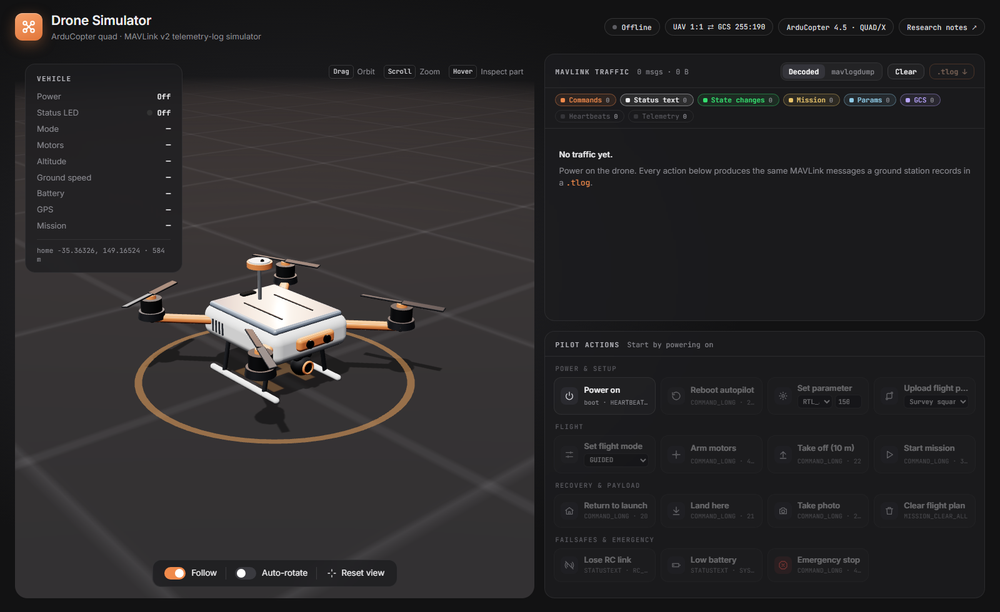

# Drone Simulator & Forensics: MAVLink flight-log forensics

An interactive, 100% client-side simulator of an **ArduCopter quadcopter** that shows, live, the **MAVLink messages a ground control station records in its telemetry log (`.tlog`)** when a drone pilot takes an action. It is meant for earning drone forensics: power the drone on, upload a flight plan, arm, take off, trigger failsafes and watch exactly what ends up in the log.

**Live demo:** https://a-aadam.github.io/Drone-Forensics/

## Backstory

Early October 2026, HackTheBox released their Drone Forensics Sherlock CTF for free for a limited time. I took a shot at time; I spent more time researching how a drone works, it's log messages and what tools to use and which ones wouldn't require major install setup. Checking the official writeup, I saw that they used Pymavlink & mavutil: so I settled for it and completed the CTF.

I also went ahead and asked ChatGPT to make use of Pymavlink to analyze the .tlog file, I asked the questions from the CTF and ChatGPT got some of the answers.

I then went to ClaudeCode to make a quick tool to help me view the logs that a drone generates to help me learn visually how things work (that is; without buying drone to crash). Hence, it gave birth to 'Drone Simulator'.



## Features

- **3D drone model** (Three.js, built in code, no model files) with an ArduPilot-style status LED, front/rear
  orientation LEDs, spinning props, GPS mast, landing gear and a camera gimbal. Hover a part to inspect it.
- **Animations tied to the vehicle state**: LEDs boot and change pattern with GPS lock, arm state and failsafes;
  props idle when armed; the drone climbs, hovers with a slight rock, banks into turns, flies the mission and
  falls after an emergency motor stop. A follow-camera, flight trail and waypoint markers are drawn in the scene.
- **Real MAVLink v2 frames.** Every message is byte-encoded with the same wire order, `CRC_EXTRA` and checksum
  that **pymavlink** uses. The message definitions are generated from pymavlink itself.
- **Log window** with two views:
  - *Decoded*: direction (↑ GCS→vehicle / ↓ vehicle→GCS), message name, a short summary and an explanation.
    Click a row to see every field with its enum name, the exact `print(msg)` text and the raw frame in hex.
  - *mavlogdump*: the exact text `mavlogdump.py` would print.
  - Category filters (commands, status text, state changes, mission, params, GCS, heartbeats, telemetry).
- **Download the session as a `.tlog`.** It opens in `mavlogdump.py`, pymavlink `mavutil`, Mission Planner or
  MAVExplorer, so you can practise log analysis on a flight you just flew.

## .tlog log viewer (`tlog.html`)

Click **Upload .tlog file** in the header to open your own telemetry log (max 5 MB). The file is decoded
**in your browser**; nothing is uploaded to a server.

- **Full ArduPilot dialect decoding** (MAVLink 1 and 2, all 301 `ardupilotmega` messages) with CRC checks and
  resynchronisation past corrupt bytes. The decoded text is identical to pymavlink's `print(msg)`.
- **Log summary**: start time, duration, vehicle and GCS ids, firmware, home position, max altitude, distance
  flown, and frame integrity (CRC errors / bad bytes, which can indicate corruption or tampering).
- **Search** in three complementary ways:
  - free text over the message name, the decoded fields and the readable summary (MAV_CMD names, flight modes…):
    `arm takeoff` (AND), `"Need Position"` (phrase), `-PreArm` (exclude), `/fail(safe|ed)/` (regex);
  - **presets** for common forensic questions (arming, mode changes, failsafes, flight-plan upload, parameter
    changes, home location, firmware identity, …);
  - **message type** and **source** (`sysid:compid`) dropdowns, plus the same category pills as the simulator.
- **Virtualised list** that stays fast on 100k+ messages, a *mavlogdump* view, a message inspector
  (fields, enum names, raw hex) and **Export view** to a text file.
- **3D flight replay** (*View simulation*): the recorded path, attitude, flight mode, arming and motor outputs,
  played back at 1–60× with a timeline of mode changes, arming, warnings and photos. Clicking a log row seeks the
  replay, and with *Sync log* the list follows playback.
- Open a log from a link: `tlog.html?log=<url-of-a-.tlog>&sim=1` (the host must allow CORS).

## Pilot actions

| Action | Key MAVLink traffic |
|---|---|
| Power on / off | boot `HEARTBEAT` + `STATUSTEXT` banner, GCS handshake, parameter download / silence (log gap) |
| Reboot autopilot | `COMMAND_LONG` 246 → `COMMAND_ACK`, then a new boot |
| Set parameter | `PARAM_SET` → `PARAM_VALUE` echo |
| Upload flight plan | `MISSION_COUNT` → (`MISSION_REQUEST` ↔ `MISSION_ITEM_INT`)×n → `MISSION_ACK` |
| Clear flight plan | `MISSION_CLEAR_ALL` → `MISSION_ACK` |
| Set flight mode | `COMMAND_LONG` 176 → `COMMAND_ACK` → `HEARTBEAT.custom_mode` |
| Arm / disarm | `COMMAND_LONG` 400 → `COMMAND_ACK`, `Arming motors` / pre-arm failures |
| Take off | `COMMAND_LONG` 22 (param7 = altitude) |
| Start mission | `COMMAND_LONG` 300 → AUTO, `Mission: n WP`, `MISSION_ITEM_REACHED` |
| Return to launch / Land | `COMMAND_LONG` 20 / 21, automatic disarm on touchdown |
| Take photo | `COMMAND_LONG` 203 → `CAMERA_FEEDBACK` (geotag) |
| Lose RC link | `Radio Failsafe` → automatic RTL |
| Low battery | `Battery 1 is low …` → automatic RTL |
| Emergency stop | `COMMAND_LONG` 400 with `param2 = 21196` (force disarm in flight) |

The simulator also models realistic refusals and automatic events: arming in a GPS mode before the EKF has a
position (`Arm: Need Position Estimate`), arming in AUTO/RTL (`Mode not armable`), disarming in flight, taking
off while disarmed, the periodic `PreArm:` reports, and the auto-disarm after `DISARM_DELAY`.

The research behind every action is in **[docs/PILOT_ACTIONS.md](docs/PILOT_ACTIONS.md)**: message sequences,
field meanings, how to read a `.tlog` with pymavlink, and what each trace tells an investigator.

## Run locally

It is a static site with no build step. Any static file server works:

```bash
node tools/serve.mjs 8080
```

Then open http://localhost:8080. (`python -m http.server` works too. Opening `index.html` directly from disk
does not, because browsers block ES modules on `file://`.)

## Analyse an exported log

```bash
pip install pymavlink
mavlogdump.py --types STATUSTEXT,COMMAND_LONG,COMMAND_ACK,HEARTBEAT drone-session-*.tlog
```

```python
from pymavlink import mavutil
mlog = mavutil.mavlink_connection("drone-session.tlog", dialect="ardupilotmega")
while (msg := mlog.recv_match()) is not None:
    print(mlog.timestamp, msg.get_srcSystem(), msg)
```

## Project layout

```
index.html                 page shell (Three.js loaded from jsDelivr via an import map)
css/style.css              styles
js/app.js                  UI: actions, log window, HUD
js/sim.js                  ArduCopter + GCS simulator (state machine, physics, telemetry)
js/scene.js                Three.js scene and drone model
js/mavlink.js              MAVLink v2 encoder, pymavlink-style formatter, .tlog writer
js/mavlink-defs.js         generated from pymavlink, simulator subset (do not edit)
js/mavlink-defs-full.js    generated from pymavlink, whole ardupilotmega dialect (do not edit)
js/logcommon.js            log rendering shared by both pages (categories, summaries, inspector)
tlog.html, css/viewer.css  .tlog viewer page
js/viewer.js               viewer UI: load, search, virtual list, details, replay controls
js/tlog.js                 .tlog parser (MAVLink 1/2, CRC check, resync)
js/replay.js               turns a decoded log into a time-indexed flight for the 3D scene
tools/gen_mavlink_defs.py  generator for both defs files
tools/serve.mjs            tiny local static server
docs/PILOT_ACTIONS.md      research notes
```

To regenerate the message definitions (for example after upgrading pymavlink or adding messages):

```bash
pip install pymavlink
python tools/gen_mavlink_defs.py > js/mavlink-defs.js
python tools/gen_mavlink_defs.py --all > js/mavlink-defs-full.js
```

## Notes and limitations

- It is a teaching simulator, not SITL. Timings, physics and the telemetry set are simplified: about 12 message
  types instead of the ~30 a real ArduCopter streams.
- The firmware banner, board serial, UID and hash values are illustrative. The home position is ArduPilot's
  default SITL location (CMAC, Canberra).
- `LAND_SPEED` is set to 100 cm/s (default 50) so that landings don't take too long in the demo.

## Credits

- [MAVLink](https://mavlink.io) and [pymavlink](https://github.com/ArduPilot/pymavlink) (message definitions, `mavutil`)
- [ArduPilot](https://ardupilot.org) documentation (flight modes, pre-arm checks, failsafes, LED meanings)
- [PX4](https://docs.px4.io) MAVLink documentation, for comparison
- [Three.js](https://threejs.org)

## ClaudeCode prompt

1st Prompt:
```
I want to build a drone visualization project.
The project will be 100% client side browser based and hosted on GitHub pages.
Use pymavlink & mavutil. 
You may use other opensource information like PX4 or any other as required. 

The project will be an interactive presentation of a drone with a 3D model. 
Research and document the various actions that a user (drone pilot) can take, like but not limited to: powering on the drone, arming the motors, setting flight plans. Research the other actions and what is the log message that they generate.
I have attached a .tlog file: you can examine it to have an idea of what the logs look like and how to analyze them. This is only for your research and should not be used as an example. 
  
Put the 3D model of the drone on the left side of the page.
On the bottom half of the right side, put several actions that a user (drone pilot) can take like turning on the drone, setting a flight plan, arming the motors, based on the information that you gathered.
On the top half of the right side, put a window that would display the log messages generated when the drone pilot takes an action.  

When an action is taken, animate the drone accordingly. Example:
Turning the drone on & off would power on & off some led lights.
When the drone takes flights, the 3D model would hover and sightly rock left to right, etc

Once done, we will do some browser testing.
If OK, then make a readme.md file and push the code to my GitHub repo: [REDACTED] . The repo is already created and set to public for the GitHub pages hosting.
```

2nd Prompt:
//Note: The referred "dronesim.drawio.xml" is a little wireframe that was made in Draw.io to provide a visual referance.
//Note: The prompt's section referring to the search feature: I asked a few questions for Claude to answer; it was in plan mode.
```
Everything is good.

For the drone simulation, set the Auto-Rotate to be on by default. 

In the logs panel, on the top, you have the various 'commands', 'status text', 'state changes', 'mission, 'params', [tc...]. It would be helpful for the users to hover over the text/the respective pill-shaped icons, to have a short description of the what these refer to. It will help with usability.

At the top right of the page, there are 4 pilled-shaped icons. Do not move these icons. However, add 1 button to their left hand side called "upload .tlog file". Clicking this button would redirect the user to another page.

On this new page, keep the headers like the Icon, name (Drone Simulator), description (ArduCopter quad · MAVLink v2 telemetry-log simulator) and keep the pilled shaped icon on the right; nothing changes on that. On this "upload .tlog file" page, its button would then switch to "Drone Simulator".

Refer to the 'dronesim.drawio.xml' file for the design I have in mind. This XML should only be used as a visual guide to have an idea of what I want.

From the "upload .tlog file" page, the user would be able to upload their own '.tlog' file. The file shall be limited to a maximum of 5mb for now. 
The bar on the top should allow the user to search for specific logs. I am not sure how to do that; maybe have some kind of text search feature or some drop down feature to search for some specific logs? Or both? What would you suggest.
The logs would then appear below. 

Based on the logs, we could also have a simulation of the drone's action/path. Check for its feasibility first (like if it is not too heavy for a browser based webapp). If the drone simulation can be made, then put a button on the left as define in the XML file attached. The simulation would then slide/appear form the left of the screen and only take a maximum of 50% of browser's width. the other 50% would be for the log viewer. For both the simulation and the log view, keep the same aesthetic and design that we made previously for the first page. 

We need to do a browser testing first before updating the GitHub repo.
```

3rd Prompt (minor adjustments):
//Note: Impeccable is a Claude UI/UX skill & \[/impeccable audit] audits the UX of the buttons.
```
When you upload a .tlog file and that simulation is open at the same time, some logs are cut. As such, allow for vertical scrolling in the logs window.

Also the orange button are a little too eye-catching, try to make them more subtle while keeping the color and theme. Use /impeccable audit to investigate a better way for them.
```
